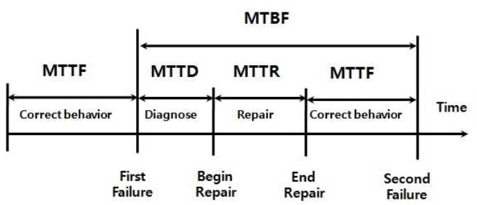
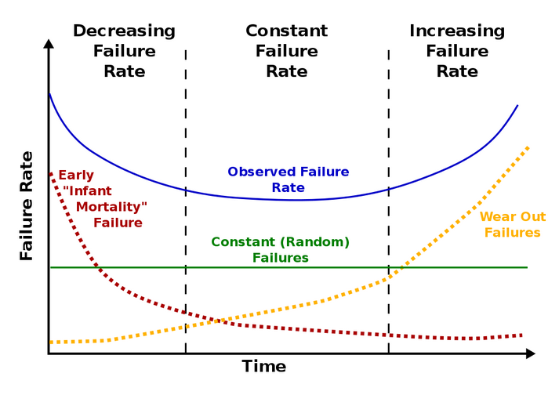

#### **Avant-propos - La fiabilité, c'est...**

-   *l'étude des défaillances des systèmes --- essentiellement des produits manufacturés (mécanique, électronique, génie civil...)* [Wikipedia](https://fr.wikipedia.org/wiki/Fiabilit%C3%A9)

-   *l'aptitude d'un dispositif à accomplir une fonction requise, dans des conditions données d'utilisation et de maintenance, pendant une durée donnée. ([Norme X05-501](http://www.qualiteonline.com/question-111-qu-est-ce-que-la-fiabilite.html))*

-   *Mathématiquement, la probabilité, dans certaines conditions de fonctionnement, qu'un article, produit, machine ou équipement exécute une fonction requise pendant une période de temps donnée. En d'autres termes, il s'agit de la probabilité de non-défaillance dans le temps.* Cette fonction est notée $R$ pour ***Reliability***

$$R(t)=\Pr(T>t)$$

où $T$ est la variable aléatoire qui associe le temps de bon fonctionnement.

L'analyse de survie est particulièrement utile pour diagnostiquer les défaillances, imprévues ou prématurées. De plus, cette analyse permet de déterminer les périodes de garantie afin d'éviter les coûts de réparations ou de remplacements excessifs.

[**Waloddi Weibull**](https://en.wikipedia.org/wiki/Waloddi_Weibull) a inventé la distribution qui porte son nom en 1937 (sa première publication date de 1939) et a présenté son article emblématique sur ce sujet en septembre 1951 devant l'ASME (American Society of Mechanical Engineers). Il illustra son exposé avec sept exemples allant de la résistance de l'acier à la taille des hommes adultes dans les îles Britanniques... Waloddi Weibull, ["A Statistical Distribution Function of Wide Applicability", *Journal of Applied Mechanics*, 1951.](http://web.cecs.pdx.edu/cgshirl/Documents/Weibull-ASME-Paper-1951.pdf)


L'avantage de sa distribution est qu'elle s'applique à un large éventail de problèmes y compris ceux dont le taux de défaillance est croissant, constant ou décroissant. Les anomalies sont mises en évidence par des graphiques qui aident les ingénieurs à diagnostiquer les causes premières des défaillances.

L'étude des défaillances des systèmes ou des durées de vie a pour objectif de répondre à des questions du type :

-   Ce système présentera-t-il des défaillances avant six mois ?

-   Ce produit répondra-t-il aux attentes qualité ?

-   Après combien de temps ce produit sera-t-il altéré dans sa fonction ?

-   La conception est-elle à revoir ?

-   Si nous constatons, sur un composant, 3 pannes sur une période de 3 mois, combien de défaillances aurons-nous le prochain trimestre, le prochain semestre ?

-   Pour commander des pièces de rechange et planifier la main-d'œuvre de maintenance, combien d'unités seront renvoyées au dépôt pour révision pour chaque mode de défaillance et à quelle fréquence ?

-   Le gestionnaire peut-il être sûr à 95 % qu'il disposera de suffisamment de pièces de rechange et de main-d'œuvre pour soutenir l'ensemble du programme de production ?

-   Après une modification technique, combien d'unités doivent être testées sans échec et pendant combien de temps pour être sûr à 95 % que l'ancien mode de défaillance est éliminé ou considérablement amélioré ?

-   Si le coût d'une défaillance non planifiée est vingt fois celui d'un remplacement prévu, quelle est la périodicité de remplacement optimale ?

-   Si le taux d'échec dépasse 2 % pendant la période de garantie, nous serons couverts. Sur la base des données historiques, à quelle date cela se produira-t-il ?

Bien que sa méthode ait été contestée dans les années 1950 (Weibull lui-même était assez sceptique...), l'analyse de Weibull est aujourd'hui très utilisée pour l'ajustement et l'analyse des données de durée de vie. L'U.S. Air Force a reconnu le mérite de la méthode de Weibull et a financé ses recherches.

Le principal avantage de l'analyse de Weibull est sa capacité à fournir un modèle raisonnablement précis avec de faibles échantillons.

Weibull a mis l'accent sur la polyvalence de sa distribution : elle dépend de trois paramètres, $\beta$, $\eta$ et $\gamma$ :

$$R(t)=e^{-\left(\frac{t-\gamma}{\eta}\right)^{\beta}}\quad (t\geq\gamma)$$

Ainsi, de nombreuses lois sont décrites par la loi de Weibull, exactement ou par approximation : la [loi exponentielle](https://en.wikipedia.org/wiki/Exponential_distribution) ($\beta=1$), la [loi de Rayleigh](https://en.wikipedia.org/wiki/Rayleigh_distribution) ($\beta=2$) et, par approximation, la [loi Normale](https://en.wikipedia.org/wiki/Normal_distribution). La [loi log-normale](https://en.wikipedia.org/wiki/Log-normal_distribution), également très utilisée en analyse de survie, fait exception.

-   Le paramètre $\beta$ s'appelle le paramètre de forme car il détermine l'allure de la courbe du taux de défaillance.

-   Le paramètre $\eta$ est le paramètre d'échelle ou durée de vie caractéristique.

-   $\gamma$ est le paramètre de position (origine des temps). Il est en général positif et correspond à une apparition retardée de la première défaillance (nous y reviendrons).

Le MTTF (*Mean Time To Failure*, temps moyen de fonctionnement avant panne) est égal à $\eta$ si $\beta=1$ et $\gamma=0$

Dans le cas général, ils sont reliés par : $MTTF=\gamma+\eta\cdot\Gamma\left(1+\frac{1}{\beta}\right)$

Le MTBF (*Mean Time Between Failures*), temps moyen entre pannes, ne doit pas être confondu avec le MTTF (*Mean Time To Failure*), temps moyen avant défaillance. Le MTBF est estimé en divisant le temps de fonctionnement total de toutes les unités par le nombre de pannes observées. Ce sont des paramètres différents, mais **égaux lorsqu'il n'y a pas de suspensions** (_en français on parle de données censurées_). Sinon, ils peuvent être très différents. 

Le MTBF est utilisé avec des systèmes réparables.



#### Les données

Il faut réfléchir aux données, car ce sont elles qui détermineront les paramètres. Comme toute analyse, la précision dépend de la quantité et de la qualité des données analysées. Dans une analyse de Weibull, il y a deux catégories de données : les temps de défaillance (TTF) et les données censurées ou suspendues.

Les données sont des intervalles de l'unité considérée (celle caractérisant la durée de vie du produit).

-   Nous avons par exemple : des durées de vie avant défaillance, le nombre de cycles démarrages/arrêts, atterrissages/décollages, les cycles de fatigue, le kilométrage...

-   Il faut choisir le bon **paramètre de vieillissement**, ce qui n'est pas toujours évident. Par exemple pour l'érosion de l'aube d'une turbine à vapeur, devons-nous tenir compte du temps de fonctionnement ou plutôt des cycles d'utilisation à telle ou telle température ?... Cela demande des connaissances en ingénierie. Dans ce cas, les graphiques de Weibull sont indispensables, le meilleur paramètre de vieillissement sera celui qui nous donnera le meilleur ajustement à une droite.

-   Il est fréquent aussi que les durées de vie ne soient pas disponibles et que nous n'ayons à notre disposition que les dates des retours clients et pas l'âge exact de fonctionnement... Ces données sont des "dirty data", par exemple est-il pertinent de ne considérer que le kilométrage d'une voiture au lieu du nombre d'arrêts/démarrages ?

-   Il est également nécessaire de tenir compte des données censurées. En effet, nous n'avons pas toujours accès à toute l'information : on constate des états qui sont souvent le résultat de diverses perturbations, indépendantes ou non du phénomène étudié. On distingue trois types de censure :

    -   **censure à droite** : à la date $T$, il n'y a toujours pas eu de défaillance et nous arrêtons l'étude ;

    -   **censure à gauche** : à une certaine date $T$, on constate que le dispositif est défaillant, mais on ignore à quel moment la défaillance a eu lieu avant $T$ ;

    -   **censure par intervalle** : on sait seulement que la défaillance a eu lieu entre deux dates connues (par exemple deux inspections successives).

L'omission de données censurées produit des résultats qui sous-estiment la fiabilité réelle de l'élément analysé. 

#### Un exemple (tiré du [Abernethy])

Nous inspectons des rivets d'étanchéité d'un compresseur. Nous avons constaté que, sur certains rivets, la partie évasée était manquante.

Un test accéléré en laboratoire utilisant les anciens rivets a permis d'établir une référence (*baseline*). Les résultats sont présentés dans le tableau ci-dessous. Les rivets de numéros de série 3, 6 et 7 sont considérés comme des défaillances non représentatives (« suspensions »), car elles ont été produites par deux autres modes de défaillance et non par le mode étudié.

| Numéro | Temps de défaillance (min) | Remarque           |
|--------|----------------------------|--------------------|
| 1      | 90                         | F (défaillance)    |
| 2      | 96                         | F                  |
| 3      | 100                        | S (suspension)     |
| 4      | 30                         | F                  |
| 5      | 49                         | F                  |
| 6      | 45                         | S                  |
| 7      | 10                         | S                  |
| 8      | 82                         | F                  |

En première analyse, ces trois données seront ignorées (elles sont censurées : ce sont des « suspensions » à droite), mais elles seront correctement prises en compte par la suite. Il reste donc cinq défaillances pour le mode étudié.

Pour estimer les fréquences des défaillances, l'approximation de [Benard], dite méthode des rangs médians (*Benard's Median Rank*), est la plus populaire (voir [Johnson 1964]).

$$
\text{Rang médian de Benard} = \frac{i-0.3}{N+0.4}
$$

où $i$ est le rang de la défaillance et $N$ la taille de l'échantillon (ici $N=5$, car nous ignorons pour l'instant les suspensions).

Nous obtenons :

+---+----------------+----------------+
| i | Temps t (min)  | Rang médian %  |
+===+================+================+
| 1 | 30             | 12.96          |
+---+----------------+----------------+
| 2 | 49             | 31.48          |
+---+----------------+----------------+
| 3 | 82             | 50             |
+---+----------------+----------------+
| 4 | 90             | 68.52          |
+---+----------------+----------------+
| 5 | 96             | 87.04          |
+---+----------------+----------------+

Que nous pourrions retrouver avec R par :

```{r}
ppoints(5, a = 0.3)
```

Précédemment nous avions ignoré certaines données (celles "censurées"). Or ces données ont une influence même si elles ne sont pas tracées. L'ordre de classement et les rangs médians doivent être ajustés en tenant compte de ces données censurées.

[Leonard Johnson](https://www.weibull.com/hotwire/issue187/hottopics187.htm) a donné une méthode qui tient compte des données censurées, puis elle fut améliorée et simplifiée par [Drew Auth (voir page 52)](https://repositorio.ufsc.br/bitstream/handle/123456789/214656/PEAS0324-D.pdf?sequence=-1).

Formule d'ajustement des rangs :

On note $RA_k$ le rang ajusté de la $k$-ième défaillance, $N$ le nombre total d'unités (suspensions comprises) et $r$ le rang inverse de la défaillance, c'est-à-dire le nombre d'unités encore en fonctionnement à cet instant (la défaillance étant comptée) :

$$RA_k=\frac{r\cdot RA_{k-1}+N+1}{r+1}\quad\text{avec } RA_0=0$$

+------+------+------+----------------------------+-----------------+
| i    | t    | r    | RA                         | Rang médian     |
+======+======+======+============================+=================+
| 1    | 10S  | 8    | Suspended                  |                 |
+------+------+------+----------------------------+-----------------+
| 2    | 30F  | 7    | (7×0+8+1)/(7+1)=1.125      | 9.8%            |
+------+------+------+----------------------------+-----------------+
| 3    | 45S  | 6    | S                          |                 |
+------+------+------+----------------------------+-----------------+
| 4    | 49F  | 5    | 2.438                      | 25.4%           |
+------+------+------+----------------------------+-----------------+
| 5    | 82F  | 4    | 3.750                      | 41.1%           |
+------+------+------+----------------------------+-----------------+
| 6    | 90F  | 3    | 5.063                      | 56.7%           |
+------+------+------+----------------------------+-----------------+
| 7    | 96F  | 2    | 6.375                      | 72.3%           |
+------+------+------+----------------------------+-----------------+
| 8    | 100S | 1    | S                          |                 |
+------+------+------+----------------------------+-----------------+

Le rang médian se déduit ensuite de la formule de Benard appliquée au rang ajusté, avec $N=8$ : $\frac{RA-0.3}{N+0.4}$.

Nous retrouvons facilement les rangs ajustés avec le package **[WeibullR](https://cran.r-project.org/web/packages/WeibullR/index.html)**

```{r warning=FALSE}
library(WeibullR)
failures<-c(30,49,82,90,96)
suspensions<-c(10,45,100)
(getPPP(failures,suspensions))
```

La colonne `ppp` donne les rangs médians calculés par WeibullR : ils diffèrent de l'approximation de Benard de moins de 0.2 point de pourcentage.

L'effet majeur des suspensions est d'augmenter $\eta$ ; $\beta$ sera peu affecté. Par conséquent, ignorer les suspensions rendra le modèle plus pessimiste.

#### **Mise en pratique avec R**

Reprenons l'exemple de nos rivets.

```{r}
failures <- c(30, 49, 82, 90, 96)
res <- MRRw2p(failures, bounds = TRUE, show = TRUE)
```

Avec les suspensions :

```{r}
failures <- c(30, 49, 82, 90, 96)
suspensions <- c(10, 45, 100)
res <- MRRw2p(x = failures, s = suspensions, bounds = TRUE, show = TRUE)
```

Comparons les deux cas :

```{r}
obj1<-wblr(x = failures)
obj1<-wblr.conf(wblr.fit(obj1,col="red",dist="weibull2p"),lwd=1)
obj2<-wblr(x = failures,s = suspensions)
obj2<-wblr.conf(wblr.fit(obj2,col="blue",dist="weibull2p"),lwd=1)
plot.wblr(list(obj1,obj2))
```

La droite bleue (avec suspensions) a un $R^2$ supérieur à celui de la rouge (0.953 contre 0.931). Comme nous avons pris en compte les suspensions, nous obtenons $\eta\approx 95$ (contre $\eta\approx 80$ sans suspensions).

#### Interprétation de $\beta$

Le taux d'avarie moyen par unité de temps, entre $t$ et $t+\Delta t$, est :

$$\frac{R(t)-R(t+\Delta t)}{\Delta tR(t)}$$

Donc le taux instantané est ($\Delta t \rightarrow 0$) :

$$\lambda(t)=\frac{-R'(t)}{R(t)}$$

L'étude de $\lambda$ nous donne la célèbre courbe en baignoire, qui traduit la relation entre $\beta$ et le taux de défaillance instantané. Pour la loi de Weibull :

$$\lambda(t)=\frac{\beta}{\eta}\left(\frac{t-\gamma}{\eta}\right)^{\beta-1}$$

Il est décroissant si $\beta<1$, constant si $\beta=1$ et croissant si $\beta>1$.



<br>

-   $\beta<1$ : défauts de jeunesse ou mortalité infantile. Le taux de défaillance diminue avec le temps.

-   $\beta=1$ : pannes aléatoires, c'est-à-dire indépendantes du temps. Taux de défaillance constant.

-   $1<\beta<4$ : usure précoce.

-   $\beta>4$ : usure due à la vieillesse.

#### Exemple : Courbe en S

Les données d'un diagramme de Weibull peuvent apparaître courbées ou mal ajustées, comme l'illustre la figure ci-dessous. Cela peut être dû à plusieurs modes de défaillance, à un changement soudain de la cause de défaillance ou à une évolution de l'environnement...

```{r echo=TRUE, warning=FALSE}
tf<-c(3.46,3.73,4.05,4.81,5.89,10,20,36.87, 53.91,80)
obj<-wblr(x = tf)
obj<-wblr.conf(wblr.fit(obj,col="blue",dist="weibull2p"),lwd=1,col="red")
plot.wblr(obj,main="Forme en S")
```

Cette courbe en S peut résulter du fait que la moitié de la population tombe en panne prématurément (défauts de jeunesse) tandis que le reste tombera en panne à cause d'une forte usure.

Une autre cause possible est une origine des temps mal placée : le temps peut ne pas commencer à zéro.

Par exemple, il peut être physiquement impossible que le mode de défaillance se produise au début de la vie. Une défaillance de roulement à billes due à l'écaillage ou à un déséquilibre ne peut se produire sans que la rotation du roulement n'entraîne suffisamment de dommages pour que le roulement ne soit plus en mesure de fonctionner.

Le temps commence lorsque des défaillances sont possibles.

Le modèle de Weibull à 3 paramètres détermine le paramètre $\gamma$ comme origine des temps.

```{r echo=TRUE, warning=FALSE}
tf<-c(3.46,3.73,4.05, 4.81,5.89,10,20,36.87, 53.91,80)
MRRw3p(x = tf, show = TRUE)
```

Avec $\gamma=3.44$, nous constatons une nette amélioration : le coefficient de détermination est $R^2=0.988$, contre 0.808 pour le modèle à 2 paramètres.

Le $\beta=0.435$ ($<1$) indique des défauts de jeunesse. 

Une courbe concave ($\gamma >0$) est plus fréquente qu'une courbe convexe ($\gamma<0$). Un $\gamma$ négatif est assez difficile à interpréter physiquement (vieillissement prématuré, mixage entre plusieurs modes de défaillance...)

#### Prévoir les défaillances - Analyse des risques

Une analyse des risques a été développée en 1983 chez Pratt & Whitney Aircraft [Abernethy 1983]. Aujourd'hui, on l'appelle « analyse prédictive »...

Une analyse des risques prédit le nombre attendu d'incidents pouvant survenir sur une période de temps spécifique.

Quelques exemples :

#### I] Étude adaptée de l'[Abernethy]

Soit un parc de 20 pompes : l'une est tombée en panne à 2000 heures et une autre à 3000 heures. Les 18 autres sont encore en fonctionnement (suspensions) : 5 à 1000 heures, 5 à 4000 heures, 4 à 2000 heures et 4 à 3000 heures.

Générons le tracé de Weibull :

```{r warning=FALSE}
library(WeibullR)
failures <- c(2000, 3000)
suspensions <- c(rep(c(1000, 4000), each = 5), rep(c(2000, 3000), each = 4))
res <- MRRw2p(x = failures, s = suspensions, show = TRUE)
```

Nous obtenons : $\beta\approx 2.64$ et $\eta\approx 6206$ heures. (L'Abernethy, avec son logiciel, trouve $\beta=2.63$ et $\eta=6210$ heures.)

La valeur de $F(t)$ peut être lue directement sur le tracé (fonction de répartition de Weibull) ou calculée à partir de l'équation de Weibull :

$$F(t)=1-R(t)=1-e^{-(\frac{t}{\eta})^{\beta}}$$

Par exemple, aux temps 1000 et 2000 heures :

```{r}
eta <- unname(res["Eta"])
beta <- unname(res["Beta"])
F <- function(t) 1 - exp(-(t / eta)^beta)
c(F(1000), F(2000))
```

La dernière colonne du tableau ci-dessous nous donne la probabilité qu'une pompe en état de marche à l'instant $t$ ait une défaillance entre les instants $t$ et $t+u$ :

```{r}
tps <- seq(1000, 5000, by = 1000)
Ft <- F(tps)
tab <- data.frame(
  t = tps[-5],
  `t+u` = tps[-1],
  `F(t)` = Ft[-5],
  `F(t+u)` = Ft[-1],
  `(F(t+u)-F(t))/(1-F(t))` = (Ft[-1] - Ft[-5]) / (1 - Ft[-5]),
  check.names = FALSE
)
knitr::kable(tab, digits = 3)
```

Entre 3000 et 4000 heures, la probabilité de défaillance d'une pompe encore en marche est de 15.4 %. Le taux d'avarie moyen par heure est donc de 0.0154 %.

#### II] Nous étudions les cassures de cage de roulement à billes.

Sur 6 roulements. On nous donne le nombre de cycles avant rupture : 

$4\cdot 10^{5}, 1.3\cdot 10^{5},9.8\cdot 10^{5},2.7\cdot 10^{5},6.6\cdot 10^{5},5.2\cdot 10^{5}$

Lançons une analyse :

```{r}
cycles <- c(4, 1.3, 9.8, 2.7, 6.6, 5.2)  # en unités de 10^5 cycles
res <- MRRw2p(x = cycles, show = TRUE)
```

Les fabricants de roulements nomment $L_{10}$ la durée de vie nominale, définie par une fiabilité de 90 % : 90 % des roulements atteignent ou dépassent $t=L_{10}$, soit $R(L_{10})=0.9$.

Dans notre cas, avec $R(t)=e^{-(\frac{t}{5.729})^{1.494}}$ ($t$ en unités de $10^{5}$ cycles), on trouve $L_{10}=\eta\,(-\ln 0.9)^{1/\beta}=1.27\cdot10^{5}$ cycles :

```{r}
unname(res["Eta"] * (-log(0.9))^(1 / res["Beta"]))
```


<br><br><br>


#### Références

-   [Abernethy] "The New Weibull Handbook" by Dr. Robert B. Abernethy Author and Publisher Fifth Edition

-   [Abernethy 1983] Abernethy, Robert B., Breneman, J.E., Medlin, C.H. et Reinman, G.L., *Weibull Analysis Handbook*, U.S. Air Force, AFWAL-TR-83-2079, novembre 1983.

-   [Benard], A., et E.C. Bos-Levenbach, "The Plotting of Observations on Probability Paper", *Statistica Neerlandica*, vol. 7, 1953, p. 163-173.

-   [Johnson 1964] Johnson, Leonard G., "Median Ranks of Sample Values in their Populations with an Application to Certain Fatigue Studies," *Industrial Mathematics*, vol. 2, 1951. Voir aussi Johnson, Leonard G., "The Statistical Treatment of Fatigue Experiments," Elsevier Publishing Company, 1964.

-   [OpenReliability] Introducing WeibullR <http://www.openreliability.org/weibull-r-weibull-analysis-on-r/>

-   [Waloddi WEIBULL] ["A Statistical Distribution Function of Wide Applicability", *Journal of Applied Mechanics*, 1951.](http://web.cecs.pdx.edu/cgshirl/Documents/Weibull-ASME-Paper-1951.pdf)

- [WeibullR] [https://cran.r-project.org/web/packages/WeibullR/index.html](https://cran.r-project.org/web/packages/WeibullR/index.html)

------------------------------------------------------------------------

*Document créé le 1er février 2021. Révisions : 6 février 2021, 21 mars 2022, 18 novembre 2022, 11 janvier 2024, 23 novembre 2026.*
